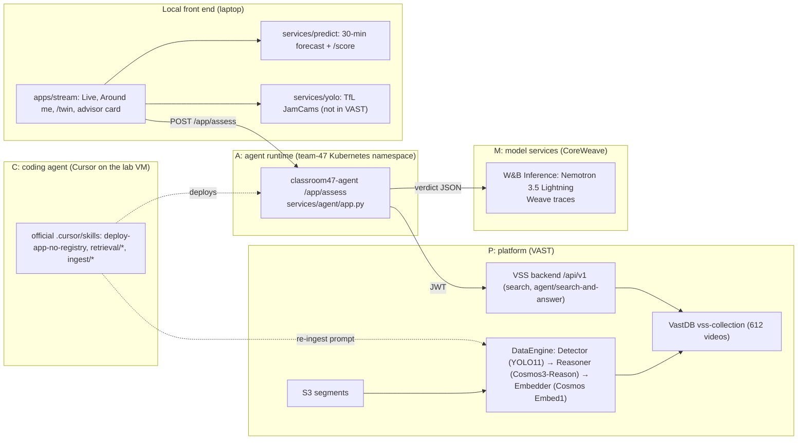

# Classroom 47: a video agent that keeps IRL streamers safe in London

> *Know what's around you. Rehearse the future before you cause it.*

An IRL streamer broadcasts their location live to thousands of people. One message to chat can summon a
crowd (Union Square 2023: 3,000–5,000 people, 65+ arrests; Oxford Street 2023: 34 dispersal orders).
Classroom 47 watches the footage around the streamer, asks the video what is happening, and tells them
`calm | busy | danger`, with the clips that prove it and a safer spot to move to.

Built on **17 October 2026** at the **VAST Builders Challenge: Real-Time Video Agents Hack, London**
([tokens&](https://tokensand.com/vastlondon)). Team 47. Public repo: `chocoliticekreem/classroom-47`.

- Compliance with the official guide, gaps and what to do next: [`docs/COMPLIANCE.md`](docs/COMPLIANCE.md)
- 2-minute and 3-minute demo scripts: [`docs/DEMO.md`](docs/DEMO.md)
- Event facts, rules and the submission checklist: [`AGENTS.md`](AGENTS.md)
- Repo state and next steps: [`HANDOFF.md`](HANDOFF.md). How to build on CAMP: the [`vast-camp` skill](.agents/skills/vast-camp/SKILL.md)
- The official guide, vendored read-only: [`vast-builders-challenge/`](vast-builders-challenge/) (`npm run vast:guide`)

## What it does

1. **Stream** (`apps/stream`, Live tab): the streamer goes live from a phone or webcam. The page knows
   where they are (GPS) and how many viewers are watching.
2. **Advisor** (the card on the stream page): every minute, and whenever the streamer asks *"should I tell
   chat where I am?"*, the page calls our **agent on the VAST cluster** (`POST /app/assess`). The agent
   searches the team's VSS index for streamer-safety moments (crowds gathering, people moving towards or
   filming the camera holder, blocked crossings), reads the Cosmos descriptions and YOLO counts of the
   moments it found, and asks an LLM on W&B Inference for a verdict: `calm | busy | danger`, two sentences
   of advice, the reasons, and the evidence clips with timestamps. Every assess is one Weave trace.
3. **Around me**: live London context from TfL JamCams (with local YOLO counts), buses, road disruptions
   and Open-Meteo weather, around the streamer's real position.
4. **3D twin** (`/twin`): a real-OpenStreetMap twin of Tower Hill with live people, buses, CCTV frames and
   a calmer-route planner (the "safer spot").
5. **Predict** (`services/predict`): a MiroFish-style 30-minute crowd forecast seeded from the live field,
   with a *what-if* ("I tell chat my location") and `/score`, which grades the forecast against what the
   cameras saw when the time arrived.
6. **Follower watch** (PR #15): warns when the same person keeps appearing behind the streamer.
   **Chat that reacts to the stream** (PR #16): chat lines conditioned on what W&B vision sees in the frame.

## Sponsor tools and where they are used

| Sponsor | Tool | Where in this project |
|---|---|---|
| **VAST Data** | VSS Blueprint API (`/api/v1/search`, `/api/v1/agent/search-and-answer`), VastDB-backed index of 612 pre-ingested videos, team Kubernetes namespace | `services/agent/app.py` (`VssClient`), deployed as `classroom47-agent` on the team-47 cluster at `/app` |
| **NVIDIA** | Cosmos3-Reason descriptions (`reasoning_content`) and YOLO11 object counts (`object_counts`) of every VSS moment | Returned by VSS, read by the agent and shown as evidence in the advisor card. Cosmos Embed1 powers the semantic search itself |
| **NVIDIA** | Nemotron on W&B Inference: `nvidia/NVIDIA-Nemotron-3.5-Lightning-30B-A3B` (agent verdict, Predict), `nvidia/NVIDIA-Nemotron-3.5-Super-VL-120B-A12B` (chat scene vision) | `services/agent/app.py` (`WANDB_MODEL` on the cluster), `apps/stream/src/app/api/agent/assess`, `apps/stream/src/app/api/chat/scene`, `services/vision/models.py` |
| **Weights & Biases** | Serverless Inference (`https://api.inference.wandb.ai/v1`) and **Weave** tracing | Every agent assess and every Predict LLM call is a `weave.op` in project `anson9m23-chocoliticekreem-codes/classroom-47` |
| **CoreWeave** | GPUs behind Cosmos, YOLO and W&B Inference | Through the stack above |
| **Cursor** | Coding agent on the lab VM over Remote-SSH, with the official skills | Deploy and re-ingest run from Cursor on the VM; team rules in `.cursor/rules/classroom-47.mdc` |
| Ultralytics **YOLO** (local) | YOLO11n + ByteTrack on TfL JamCam clips | `services/yolo/server.py`. Live London bonus; this footage is never put into VAST |

## Architecture: the CAMP layers



The CAMP mapping per component is in [`docs/ARCHITECTURE.md`](docs/ARCHITECTURE.md).

## How to run

The agent already runs on the cluster. Open https://workshop.thecosmoslabs.com → **App**, or:

```bash
APP=https://video-lab-team-47.cosmos.vastdata.com
curl -s "$APP/app/health"        # {"ok": true, "vss": true, "wandb": true}
```

Local front ends, from the repo root:

```bash
npm install            # once (npm workspaces)
npm run vast:guide     # fetch the official VAST guide submodule (read-only)
npm run dev:stream     # stream page, Around me, /twin, advisor: http://localhost:3047
npm run yolo           # local YOLO for Around me: http://127.0.0.1:8047 (needs uv)
npm run predict        # Predict forecast service: http://localhost:8048 (needs uv)
```

`apps/stream` reads `AGENT_URL` (default `http://video-lab-team-47.cosmos.vastdata.com/app`),
`PREDICT_URL`, `JAMCAM_YOLO_URL` and `WANDB_*` from `apps/stream/.env.local` (gitignored). Values live in
`/config/team-47.config` on the lab VM and are never committed. Don't use the root `npm run dev`, `build`
or `lint`; they target an `api` workspace that isn't in this repo.

## Inputs, outputs and evaluation

**Inputs**
- The team's VSS index: 612 pre-ingested videos across `sf_streets_cam-1…5`, `nyc_streets_cam-1…2`,
  `smartspace_cam-1`, `pie_cam-3`, `neighborhood_cam-1`, `i24_cam-1`, `sdg_warehouse_cam-2`, each segment
  with a Cosmos3-Reason description, YOLO11 object counts and a Cosmos Embed1 vector.
- Live London: the streamer's GPS position and viewer count; TfL JamCams with local YOLO people and vehicle
  counts; TfL buses and disruptions; Open-Meteo weather.
- The streamer's question (default: *"Is it safe to keep streaming here, and should I tell chat where I am?"*).

**Outputs**
- `POST /app/assess` → `{level, advice, reasons[], evidence[{video, start_s, end_s, description, similarity,
  camera, counts}], vss_answer, trace: {weave_project}}`. Shown in the advisor card and published on the
  page bus as `surroundings.update`.
- A calmer route in the twin, and a Predict report (`report.changes`, confidence, explicit assumptions) with
  a 60 s timeline.

**Evaluation steps** (each is one command; results from 17 Oct 2026, 12:50 BST)

1. **Search quality, hit@k.** Eight streamer-safety queries, each paired with the cameras whose footage should
   answer it. A query is a hit when an expected camera appears in the top-k VSS moments. Run on the lab VM
   (credentials from `/config/team-47.config`, never printed):

   ```bash
   cd services/agent
   INGRESS_URL=$INGRESS_URL USERNAME=$USERNAME PASSWORD=$PASSWORD python3 eval_search.py --top-k 8
   ```

   | query | moments | first expected camera at | top similarity | hit@8 |
   |---|---|---|---|---|
   | a large crowd of pedestrians crossing a busy city intersection | 8 | 1 | 0.566 | yes |
   | people waiting at the curb while vehicles stop at the crosswalk | 8 | 1 | 0.528 | yes |
   | a person walking towards the camera holding a phone | 8 | 2 | 0.270 | yes |
   | pedestrian close to a moving vehicle on the road | 8 | 1 | 0.295 | yes |
   | group of people gathering indoors in a corridor | 8 | 1 | 0.436 | yes |
   | a forklift driving down a warehouse aisle near a person | 8 | 1 | 0.527 | yes |
   | dense traffic on a multi-lane highway | 8 | 1 | 0.465 | yes |
   | someone filming the camera holder or following them | 2 | - | 0.218 | **no** |

   **hit@8 = 7/8.** The miss is the gap the official guide predicts: the default ingest prompt never asked
   Cosmos whether anyone is filming or following the camera holder, so nothing was written down. The fix is a
   re-ingest with our prompt (`docs/COMPLIANCE.md`, "Do next" #1); re-run the same command afterwards and
   compare.

2. **The agent end to end.** One verdict with evidence from the cluster (takes 20–40 s):

   ```bash
   curl -s -X POST https://video-lab-team-47.cosmos.vastdata.com/app/assess \
     -H 'Content-Type: application/json' \
     -d '{"question":"Is a crowd building around me?","location":{"name":"Tower Hill","lat":51.5098,"lon":-0.0766},"yolo":{"people":42,"vehicles":6,"camera":"JamCams_00001.07501"}}'
   ```

   Observed 12:52 BST: `level: busy`, 3 reasons, evidence from `nyc_streets_cam-2` (12 people, 3 cars) and
   `sf_streets_cam-1` (8 people, 5 cars) with similarity 0.34, Weave trace in
   `anson9m23-chocoliticekreem-codes/classroom-47`.

3. **Forecast against reality.** Start a Predict run, wait for the first due step, then score it. `/score`
   compares predicted vs actual people per camera and zone and reports `right`/`wrong` (within 30 % or 2
   people) and the mean absolute error:

   ```bash
   RUN=$(curl -s -X POST http://localhost:8048/predict -H 'Content-Type: application/json' -d '{"horizonMin":30}' | python3 -c 'import sys,json;print(json.load(sys.stdin)["runId"])')
   sleep 300
   curl -s -X POST http://localhost:8048/score -H 'Content-Type: application/json' -d "{\"runId\":\"$RUN\"}"
   ```

4. **Live counts.** With `npm run yolo` running: `curl -s 'http://127.0.0.1:8047/counts?ids=JamCams_00001.07501'`
   returns people and vehicle counts for that JamCam; the same numbers feed the advisor's `yolo` field.

## Repo layout

| Path | What |
|---|---|
| `services/agent/` | **The CAMP agent** on the cluster: `app.py`, `requirements.txt`, `eval_search.py`, `eval_queries.json`, deploy steps in its README |
| `services/predict/` | MiroFish-style forecast + `/score` (W&B + Weave) |
| `services/yolo/` | Local YOLO11 + ByteTrack on TfL JamCams |
| `services/vision/` | Model clients: Nemotron VL on W&B, Cosmos3-Reason and Embed1 on the event GPU endpoints, camera calibration |
| `apps/stream/` | Next 16 front end: Live, Around me, `/twin`, advisor card, Predict panel, `/api/around/*`, `/api/agent/assess`, `/api/predict` |
| `apps/web/` | An earlier 3D city prototype, not part of the demo (build blocked; see `HANDOFF.md`) |
| `docs/` | `COMPLIANCE.md`, `DEMO.md`, `ARCHITECTURE.md`, `PMF.md` |
| `vast-builders-challenge/` | The official guide and skills, as a submodule |

## Submission checklist (16:30 BST)

- [ ] Public repo `chocoliticekreem/classroom-47` on `main`, README current (this file)
- [ ] Demo video recorded (backup by 15:30) and uploaded as a shareable link
- [ ] Submission form at https://tokensand.com/vastlondon → *Submit your project*: what we built, the sponsor
      tools above, the repo link, the video link, a screenshot, **every team member listed**
- [ ] `curl https://video-lab-team-47.cosmos.vastdata.com/app/health` returns `vss: true, wandb: true` at 16:40
- [ ] 2-minute live demo rehearsed with cached inputs ([`docs/DEMO.md`](docs/DEMO.md)); Weave project open in a tab
